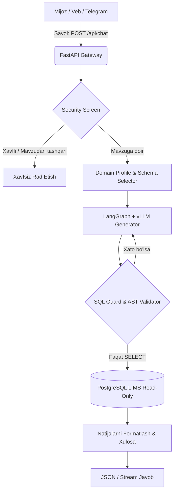

# 🔬 MyCoal.uz LIMS AI Assistant · Text-to-SQL & Analytics Engine

[](https://python.org)
[](https://fastapi.tiangolo.com)
[](https://github.com/langchain-ai/langgraph)
[](https://vllm.ai)
[](https://postgresql.org)
[](https://docker.com)
[](LICENSE)

> **«Mycoal.uz» platformasi haqida:** (Mycoal.uz) — O‘zbekistonda aholi va ijtimoiy soha muassasalarini ko‘mir yoqilg‘isi bilan ta’minlash, savdo va yetkazib berish jarayonlarini raqamlashtirishga mo‘ljallangan yagona elektron platformadir.

Ushbu servis **Mycoal.uz** ekotizimi va «O'zbekko'mir» korxonasining **LIMS (Laboratory Information Management System)** ma'lumotlar bazasi uchun maxsus ishlab chiqilgan intellektual AI yordamchisidir.

Foydalanuvchi tabiiy tilda (o'zbek, rus, ingliz) bergan savollarini avtomatik ravishda xavfsiz SQL (`SELECT`) so'roviga aylantiradi, read-only bazada bajaradi va laboratoriya tahlillari hamda logistika ko'rsatkichlari bo'yicha aniq tahliliy hisobot qaytaradi.

---

## 📑 Mundarija
- [Asosiy Imkoniyatlar](#-asosiy-imkoniyatlar)
- [Ko'mir Sohasi Ma'lumotlar Domeni (Domain Knowledge)](#-komir-sohasi-malumotlar-domeni)
- [Tizim Arxitekturasi](#-tizim-arxitekturasi)
- [Xavfsizlik Kafolatlari](#-xavfsizlik-kafolatlari)
- [API Hujjatlari](#-api-hujjatlari)
- [Ishga Tushirish (Quickstart)](#-ishga-tushirish-quickstart)
- [Bog'lanish](#-boglanish)

---

## 🌟 Asosiy Imkoniyatlar

* **Tabiiy Tildan SQL ga (Text-to-SQL):** O'zbek tilidagi murakkab laboratoriya va logistika savollarini aniq PostgreSQL so'rovlariga aylantirish.
* **Ko'p Bosqichli Orkestratsiya (LangGraph):** Savolni tekshirish (screen) → tegishli sxemani tanlash → SQL generatsiya qilish → sintaksis va xavfsizlikni tekshirish → xatolikda qayta tuzatish (self-correction).
* **Kontekstual Suhbat Xotirasi:** Oldingi savollarni eslab qolish («ulardan qaysilari 20% dan yuqori namlikka ega?») va davomli muloqot yuritish.
* **Dual Format Javob:** Ham tushunarli matnli tahlil, ham to'liq jadval ko'rinishidagi xom ma'lumotlar.

---

## ⛏ Ko'mir Sohasi Ma'lumotlar Domeni

Tizim «O'zbekko'mir» LIMS bazasidagi 137 ta jadval/view va 1 700+ ustunlar ustida ishlaydi:
* **Ko'mir laboratoriya tahlillari:** Namlik, kullilik (ash content), fraksiya o'lchamlari va radiatsiya tahlillari (`laboratory_results`).
* **Transport va logistika:** Vagon hisob dalolatnomalari, avtotransport kiritish-chiqarish hujjatlari, tortish ma'lumotlari.
* **Ishlab chiqarish quvvatlari:** Uchastkalar, ekskavatorlar ish jurnali va smenalar kesimidagi yuklash hajmlari.

---

## 🏗 Tizim Arxitekturasi



---

## 🔒 Xavfsizlik Kafolatlari

1. **Transaction Level READ-ONLY:** Baza sessiyasida hech qanday yozish yoki o'zgartirish (`INSERT`, `UPDATE`, `DELETE`, `DROP`) amallari bajarilmaydi.
2. **SQL Guard & AST Tekshiruvi:** Til modeli yaratgan SQL so'rovi qat'iy tekshiriladi; ruxsat etilmagan funksiyalar yoki tizim jadvallari chaqirilsa, so'rov to'xtatiladi.
3. **Resurs Cheklovlari:** Har bir so'rov uchun `STATEMENT_TIMEOUT_MS=15000` va `SQL_ROW_LIMIT=500` majburiy qo'llaniladi.

---

## 🚀 API Hujjatlari

Barcha endpointlar HTTP Basic Auth bilan himoyalangan (`/docs` orqali sinab ko'rish mumkin):

| Metod | Endpoint | Tavsif |
|---|---|---|
| `POST` | `/api/chat` | Savol berish va SQL tahlil natijasini olish (Sessiya ID bilan) |
| `POST` | `/api/chat/stream` | Server-Sent Events (SSE) orqali streaming javob |
| `GET` | `/api/schema` | Joriy bazaning faol domen profili va jadvallar ro'yxati |
| `GET` | `/health` | Servis sog'lomligi va baza ulanishini tekshirish |

---

## 💻 Ishga Tushirish (Quickstart)

```bash
# 1. Reponi klonlash
git clone https://github.com/quvonchbek212/mycoal-lims-chatbot.git
cd mycoal-lims-chatbot

# 2. Virtual muhit va kutubxonalar
python -m venv .venv
source .venv/bin/activate  # Windows: .venv\Scripts\activate
pip install -r requirements.txt

# 3. Sozlamalar
cp .env.example .env
# .env faylida vLLM va PostgreSQL parametrlarini ko'rsating

# 4. Serverni ishga tushirish
uvicorn main:app --host 0.0.0.0 --port 8080 --reload
```

---

## 📬 Bog'lanish

* **Muallif:** Quvonchbek Begimqulov
* **LinkedIn:** [linkedin.com/in/kuvonchbek-begimkulov](https://linkedin.com/in/kuvonchbek-begimkulov)
* **Email:** [begimqulovquvonchbek53@gmail.com](mailto:begimqulovquvonchbek53@gmail.com)
* **GitHub:** [@quvonchbek212](https://github.com/quvonchbek212)
